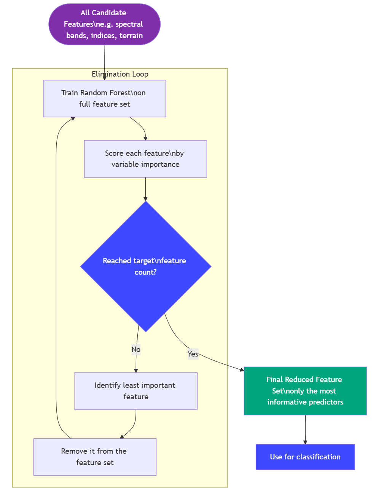

# Predictor Generation {#sec-module-5}

# Module Overview {.unnumbered}

The aim of Module 5 is to derive a set of predictors that optimize the discrimination of LULC classes in the classification model. Currently, Luma Geospatial Engine supports predictors derived from several categories, namely spectral transformations, topographical data, distance-based metrics, and radar backscatter. These features are critical because raw spectral data alone often fail to adequately separate spectral or spatially similar classes, and their inclusion enhances model accuracy and robustness.

The module outputs a comprehensive predictor stack that serves as input for LULC map generation in Module 6.

# Input {.unnumbered}

| Name of Input | Input Type | Details |
|------------------------|------------------------|------------------------|
| spectral transformations | System’s input | Retrieve the pre-define function from existing library |
| Topographical Data | System’s input |  |
| Distance-based metrics | System’s input |  |
| Radar Backscatter | System's Input |  |
| AOI | Input from Other Modules | Output from @sec-module-1 |
| Near-cloud free satellite imagery | Input from Other Modules | Output from @sec-module-1 |
| Sample data | Input from Other Modules | Output from @sec-module-3 |

# Output {.unnumbered}

Predictor/covariate/feature stack used in the classification model (Module 6)

# Process {.unnumbered}

## Predictor Availability Check and Selection {#sec-selection-of-predictors}

1.  The Luma GE supports various predictors that can be compute on the fly or manually uploaded by the user. The supported predictor categories are as follow:

    -   Spectral transformation

    -   Topographical data

    -   Distance from feature

    -   Radar Backscatter

2.  The system perform confirmation availability of user selected predictors by confirming sensor selection and temporal coverage

    ::: callout-tip
    ## Related Function

    `predictor.predictor_catalog()` : central registry for supported predictor in Luma GE

    `predictor.predictor_catalog.get_all_catalog()` : Return a copy of the entire predictor catalog dictionary.

    `predictor.predictor_catalog.check_availability()` : Evaluate availability for all registered predictors based on sensor and temporal range.

    `predictor.sensorDetector()` : Utility for detecting satellite sensor category and resolving sensor-specific band mappings.

    `predictor.sensorDetector.normalize_sensor_name()`: Normalize a sensor string hint into a canonical sensor family.

    `predictor.sensorDetector.detect_sensor_from_bands()`: Detect sensor category from a list of band names. Sentinel-2 contains "Red-edge" bands, while Landsat contains "thermal" band, which can serves as sensor identifier

    `predictor.sensorDetector.detect_sensor()`: wrapper function to automatically detect sensor selection either using sensor name or band names
    :::

## Predictor Computation

1.  Topographical data

    -   **Elevation**: Refers to Digital Elevation Model (DEM) products, widely used in land cover classification framework. Several DEM is supported by Luma-GE, namely [NASADEM](https://developers.google.com/earth-engine/datasets/catalog/NASA_NASADEM_HGT_001?hl=id) (default), [Copernicus GLO-30](https://developers.google.com/earth-engine/datasets/catalog/COPERNICUS_DEM_GLO30?hl=id#bands), and [ALOS DSM V4](https://developers.google.com/earth-engine/datasets/catalog/JAXA_ALOS_AW3D30_V4_1). All of the aforementioned DEM product have the spatial resolution of 30 m

    -   **Slope**: Calculated from selected DEM using `ee.Terrain.slope` function. Slope unit is presented in degree units (0-90)

    -   **Aspect**: Similar to slope, this data is calculated from the selected DEM, using `ee.Terrain.aspect`. The units are degree where 0=N, 90=E, 180=S, 270 =W

    -   **Landform**: Refers to physical terrain attributes and classifications calculated from grid-based surface elevation values. Luma use global ALOS Landform dataset created by combining the Continuous Heat-Insolation Load Index (CHILI) and the multi-scale Topographic Position Index (mTPI) data

    ::: callout-tip
    ## Related Functions

    `predictor.terrain_calculator.calculate_elevation` : Function to retrieve supported DEM data from GEE catalog.

    `predictor.terrain_calculator.calculate_slope` : Core function to calculate slope from selected DEM data

    `predictor.terrain_calculator.calculate_aspect` : Core function to calculate aspect data from selected DEM data

    `predictor.terrain_calculator.get_landform` : Core function to retrieve global landform data and clip it based on AOI
    :::

2.  Distance-based metrics

    The system calculates distance from several features that might affect the presence of certain land cover class. The selection and distance calculation of these features are inspired by RESTORE+ project. Distances can be measured from various infrastructures, primarily roads, coastlines, and settlements. Since distance calculation required heavy computation, pre calculated euclidean distance will be stored in the asset for three province in Indonesia, namely South Sumatera, South Sulawesi, and East Nusa Tenggara. For other regions, distance computation will be calculated on the fly currently supporting distance from primary roads. The road feature collection use as the basis for distance calculation, utilize Global Road Inventory Projects [@meijer_global_2018].

    ::: callout-tip
    ## Related Functions

    `predictor.distance_calculator.calculate_distance_metrics`: Core function to initialize the distance calculation logic for coastline, road, and settlement

    `predictor.get_predefine_distance` : function to retrive pre-calculated distance from main road raster from earth engine asset.
    :::

    Currently, the system support distance calculation from the following source:

    -   Coastline: [Natural Earth 10m coastline data](https://www.naturalearthdata.com/downloads/10m-physical-vectors/10m-coastline/),

    -   Settlement: [Facebook High Resolution Settlement Layer (HRSL)](https://dataforgood.facebook.com/dfg/tools/high-resolution-population-density-maps)

    -   Road: Indonesian Topographic Map (*Rupa Bumi Indonesia*) and OpenStreetMap

3.  Spectral transformation indices

    Luma utilize open-source [Awesome Spectral Indices](https://github.com/awesome-spectral-indices/spyndex) (ASI) library, a standardized, ready-to-use curated list of spectral indices that can be used as expressions for computing spectral indices in remote sensing applications. Therefore, manually defining the expression is not required. However, when adding a new index, it should be cross-reference with the availability of the index in the library. For further reading on the formulation of the library and its supported indices, see [@montero_standardized_2023]. Currently, the supported index in Luma are as follows:

    -   Vegetation-related indices:

        -   NDVI (Normalized Difference Vegetation Index)

        -   EVI (Enhanced Vegetation Index)

        -   SAVI (Soil Adjusted Vegetation Index)

        -   MSAVI (Modified Soil Adjusted Vegetation Index)

        -   GNDVI (Green Normalized Difference Vegetation Index)

        -   MCARI1 (Modified Chlorophyll Absorption in Reflectance Index 1)

    -   Water-related indices:

        -   MNDWI (Modified Normalized Difference Water Index)

        -   ANDWI (Augmented Normalized Difference Water Index)

        -   NDMI (Normalized Difference Moisture Index)

        -   AWEInsh (Automatic Water Extraction Index with Shadow Elimination)

        -   NDTI (Normalized Difference Turbidity Index)

    -   Soil / built-up-related indices:

        -   NDBI (Normalized Difference Build-Up Index)

        -   DBSI (Dry Bareness Soil Index)

        -   MBI (Modified Build-up Index)

        -   BLFEI (Built-Up Land Feature Extraction Index)

    ::: callout-tip
    ## Related Functions

    `predictor.SpectralCalculator.get_avaliable_indices`: Return the list of supported indices. This list contain information regarding the Index name, long-name, formula, and references

    `predictor.SpectralCalculator.get_index_coefficients`: Get default coefficient values for a spectral index that needs user-define coefficients and parameters

    `predictor.SpectralCalculator.validate_coefficients`: Conducts checks the provided coefficients are within reasonable ranges and provides warnings for unusual values that might indicate errors.

    `predictor.SpectralCalculator.validate_index_requirements` : Validate that required bands are available for index computation.

    `predictor.SpectralCalculator.calculate_indices_with_collection`: Conducts calculation for each scene (image collection) and then aggregate the result using mean reducers. This logic is used to preserve phenological pattern of vegetation and other land features which ultimately loss during if the final image composite is used.

    `predictor.SpectralCalculator.get_calculation_summary` : provide summary of the calculation process of predictors
    :::

4.  Radar Backscatter

    Luma-GE supports Synthetic Aperture Radar (SAR) data as predictors for classification. Because radar observations are not affected by cloud cover, they can provide useful information in cloud-prone regions and complement optical imagery. The supported datasets are:

    -   Sentinel-1 C-Band Dual Polarization

        Sentinel-1 carries a dual-polarization C-band SAR instrument. In Google Earth Engine, the available data are Ground Range Detected (GRD) products processed with the Sentinel-1 Toolbox to produce calibrated, orthorectified imagery. Luma-GE converts the log-scaled digital number (DN) values to normalized backscatter values. The dataset is available from 2014, has a six-day revisit interval at the equator, and provides 10 m spatial resolution.

    -   ALOS PALSAR/PALSAR-2

        The Advanced Land Observing Satellite ([ALOS](https://www.earthdata.nasa.gov/data/platforms/space-based-platforms/alos "ALOS")) carries the Phased Array type L-band Synthetic Aperture Radar ([PALSAR](https://www.earthdata.nasa.gov/data/instruments/palsar "PALSAR")). The PALSAR record begins in 2007 and has 25 m spatial resolution. A gap in coverage between ALOS and ALOS-2 means that data are unavailable from 2011 to 2014. Luma-GE currently supports yearly PALSAR mosaics, with the latest coverage available from January 2024. PALSAR ScanSAR data are not supported because they require extensive preprocessing.

    The Sentinel-1 preprocessing workflow refers to [@mullissa_sentinel_2021] in the following repository: [S1_ard](https://github.com/adugnag/gee_s1_ard/tree/main). Pre-processing for Sentinel-1 include IW mode filtering, incidence-angle masking, low-backscatter swath-edge masking and speckle filtering (optional). Since PALSAR dataset already a yearly mosaic product, pre-processing only include radiometric calibration (conversion from DN to Db).

    ::: callout-note
    ## Related Function

    `sar.get_sar_data:` Retrieve and preprocess SAR backscatter polarizations and polarization ratios as predictors for LULC mapping.

    `sar.get_sar_data.apply_speckle_filter():` function to perform speckle filtering for calibrated gamma-naught (dB) SAR image

    `sar.get_sar_data.mask_s1_border_and_angle():` Mask Sentinel-1 pixels with incidence angle outside \[min_angle, max_angle\] and low-backscatter swath-edge noise (VV or VH \<= edge_db_floor).

    `sar.get_sar_data.get_sentinel1():` Build sentinel-1 backscatter predictor image

    `sar.get_sar_data.mask_and_calibrate_palsar():` Mask invalid PALSAR pixels using the 'qa' band and calibrate 16-bit DN to gamma-naught (dB).

    `sar.get_sar_data._resolve_palsar_year():` resolve the available PALSAR mosaic years intersection

    `sar.get_sar_data.get_palsar():` Build PALSAR backscatter predictor image. The function handle the following PALSAR collection: `JAXA/ALOS/PALSAR/YEARLY/SAR` (2007 - 2010) and `JAXA/ALOS/PALSAR/YEARLY/SAR_EPOCH` (2015 - 2024)
    :::

    The list of radar backscatter band for each sensor are as follow:

    1.  Sentinel-1

        -   VV: single co-polarization, vertical transmit/vertical receive

        -   VH: single co-polarization, vertical transmit/horizontal receive

        -   VV-VH Ratio: Ratio between VV and VH polarization

    2.  ALOS PALSAR

        -   HH: single polarization, horizontal transmit/horizontal receive

        -   HV: single polarization, horizontal transmit/vertical receive

        -   HH-HV Ratio: Ratio between HH and HV polarization

    The main orchestration of predictor calculation is conduced after the system validate the required input. The entry point for SAR predictor is define through this source code The system combines the additional predictors chosen from this module with the multispectral bands from Module 1.

    ::: callout-tip
    ## Related Functions

    `predictor.PredictorCalculation.validate_prerequisites:` Validate that required inputs are available for predictor computation. Required input are composite (`ee.Image`), AOI (`ee.FeatureCollection`) , and raw image collection (`ee.Image.Collection`)

    `predictor.PredictorCalculation.compute_predictors` : Initialize predictor computation by validating inputs, calculating selected terrain and spectral metrics, and stacking them into a final output.

    `predictor.PredictorCalculation.prepare_module6_summary:` Prepare summary metadata for module 6

    `predictor.PredictorCalculation.resolve_date_range()`: resolve date range selection between optical imagery date selection with radar date selection. Therefore, radar date range will always follow optical date selection

    `predictor.PredictorCalculation.resolve_sar_selection()`: determine which radar sensor is selected based on user optical sensor selection
    :::

## Predictors Visualization and Analysis

This section allow the user to visualize the resulted predictors to visually inspect the spatial distribution of the data. Predictor quality analysis is heavily related with sample quality analysis modules.

1.  If the option to conduct correlation analysis was selected by the user, the system conduct correlation analysis using the following approach

    -   Creates a random sampling across the AOI (default value is 5000 points)

    -   Extract the pixel value of the computed predictors. The spectral band predictors are not extracted, since the analysis is design to analyze the correlation between ancillary predictors

    -   Computes correlation analysis using GEE's core function

2.  The correlation analysis is conducted across all predictors, including the original multispectral band

    ::: callout-tip
    ## Related Functions

    `predictor.EECorrelationAnalysis.generate_random_sampling`: Generate random sample across the AOI. Use default value of 5000 sample

    `predictor.EECorrelationAnalysis.compute_correlation`: Main function to compute Pearson correlation analysis based on the random samples generated. Return the panda data frame use for visualization.

    `predictor.EECorrelationAnalysis.visualize`: Visualize the correlation analysis result using heatmap
    :::

## Semi Automatic Predictor Selection and Recommendation

Luma GE provides recommendations for ideal predictor selection using a commonly used feature engineering approach, namely Recursive Feature Elimination (RFE) and Recursive Feature Elimination with Cross-Validation (RFECV). RFE/RFECV applies a backward step-wise selection process to find the optimal combination of predictors based on their contribution to the model. It starts by training the model with all input predictors and discards the weakest predictor(s) iteratively while re-evaluating feature importance after each removal. Luma GE supports RFE natively via Earth Engine server-side computation (`RFEGEE`) as well as a local pure-Python implementation (`RFE_CV`). The workflow for RFE is shown in the figure below:

{fig-align="center" width="710"}

### RFE-GEE

1.  Input validation

    Prior to running RFE, Luma-GE performs input validation checks to detect invalid or missing parameters and raise informative error messages. Checked inputs include training data (`ee.FeatureCollection`), optional test data (`ee.FeatureCollection`, required when `track_accuracy=True`), minimum number of features to select (`>= 1` and `<= len(features)`), and elimination `step` (`> 0`). If all inputs are valid, the RFE workflow proceeds.

    ::: callout-tip
    ## Related Function

    `predictor.RFEGEE._validate_inputs()`: Validate all inputs required for `RFEGEE` calculations, namely: `training_data` (`ee.FeatureCollection`), `test_data` (`ee.FeatureCollection` or `None`), `n_features_to_select` (`>= 1`), and `step` (`> 0`).
    :::

2.  Default RFE-GEE configuration

    -   Minimum features to select (`n_features_to_select`): `max(1, len(features) // 2)` (half of the input features, minimum 1)
    -   Number of Random Forest trees (`n_trees`): `50`
    -   Step size (`step`): `1` (supports fixed integer, fractional float, or `adaptive=True`)
    -   Auto-select optimal subset (`auto_select`): `True` (when `track_accuracy=True`)
    -   Track validation accuracy (`track_accuracy`): `False` (requires `test_data` when enabled)

    Since Earth Engine does not provide a built-in feature selection algorithm, Luma GE implements an iterative loop that trains a Random Forest classifier (`ee.Classifier.smileRandomForest`) and retrieves variable importance (and optionally test accuracy) at each iteration. The implementation is inspired by [this GitHub repository](https://github.com/DanGeospatial/GEE_Wetland_Classification).

::: callout-tip
## Related Function

`predictor.RFEGEE._train_classifier()`: Core method to train `ee.Classifier.smileRandomForest` on `training_data` using the active feature list.

`predictor.RFEGEE._get_importance_and_accuracy()`: Retrieve feature importance (from `classifier.explain()`) and optional test accuracy in a single `.getInfo()` round-trip to Earth Engine servers per iteration.

`predictor.RFEGEE._calculate_step()`: Calculate the number of features to drop in the current iteration; supports fixed integer steps, fractional steps, and `adaptive=True` (coarse halving when far from target, single-feature steps when near target).

`predictor.RFEGEE.fit()`: Conduct the complete RFE workflow, iterating through feature elimination, tracking importance and accuracy history, and auto-selecting the most parsimonious feature subset with peak accuracy when `track_accuracy=True` and `auto_select=True`.
:::

To optimize API calls to Earth Engine servers, importance and accuracy are bundled into a single `.getInfo()` call per iteration. The RFE results can be inspected and visualized using plots and tables, including the selected features, elimination rankings, and accuracy curve.

::: callout-tip
## Related Function

`predictor.RFEGEE.get_selected_features()`: Retrieve the list of selected predictor names based on the RFE result.

`predictor.RFEGEE.get_ranking()`: Return a dictionary mapping each feature to its rank (`1` = selected; higher rank = eliminated earlier).

`predictor.RFEGEE.get_support()`: Return a dictionary mapping each feature to a boolean indicating whether it was selected.

`predictor.RFEGEE.plot_accuracy_curve()`: Plot validation accuracy vs. number of features (requires `track_accuracy=True`).

`predictor.RFEGEE.plot_feature_rankings()`: Plot a horizontal bar chart of feature rankings (selected vs. eliminated).

`predictor.RFEGEE.plot_rfe_summary()`: Create a combined side-by-side summary plot of the accuracy curve and feature rankings.

`predictor.RFEGEE.get_results_dataframe()`: Generate a `pandas.DataFrame` containing feature rank, selection status, and final importance.

`predictor.RFEGEE.get_accuracy_dataframe()`: Generate a `pandas.DataFrame` containing the iteration-by-iteration feature count and accuracy history.
:::

### RFE-CV

One of the key drawbacks of `RFEGEE` is computation time, which can be slow due to repeated server-client round-trips to Earth Engine. To overcome this, Luma GE provides a local pure-Python implementation (`RFE_CV`) using `scikit-learn`'s `RFECV` and `StratifiedKFold` with a `RandomForestClassifier` wrapper (`ProgressRF`). It extracts sampled training properties from Earth Engine once (with `retainGeometry=False`) or accepts a `pandas.DataFrame` directly, runs cross-validated RFE locally with live progress reporting, and omits model accuracy outputs because `scikit-learn`'s Random Forest implementation differs from Earth Engine's `smileRandomForest`.

::: callout-note
## Related Function

`predictor.ProgressRF()`: Lightweight `scikit-learn` `RandomForestClassifier` wrapper that invokes an `on_fit` callback after each fit step to power live progress reporting during `RFECV`.

`predictor.RFE_CV._validate_inputs()`: Validate inputs for local RFECV, including `training_data` (`ee.FeatureCollection` or `pandas.DataFrame`), `features`, `n_features_to_select`, `step`, `cv` (`>= 2`), `n_trees`, `max_depth`, `min_samples_leaf`, and `max_samples`.

`predictor.RFE_CV._extract_dataframe()`: Extract `features` and `class_property` into a clean `pandas.DataFrame`. For `ee.FeatureCollection` inputs, drops geometries server-side (`retainGeometry=False`), applies balanced per-class sampling up to `max_samples`, and paginates via `ee.data.computeFeatures()`.

`predictor.RFE_CV._estimate_total_fits()`: Estimate the total number of Random Forest fits across all RFECV steps and cross-validation folds for progress bar reporting.

`predictor.RFE_CV.fit()`: Run local `scikit-learn` `RFECV` with `StratifiedKFold` cross-validation and `ProgressRF`, populating the recommended feature stack, rankings, support mask, and Gini feature importances.

`predictor.RFE_CV.get_selected_features()`: Return the list of selected predictor names from the RFECV result.

`predictor.RFE_CV.get_ranking()`: Return a dictionary mapping each feature to its RFECV rank (`1` = selected; higher values = eliminated earlier).

`predictor.RFE_CV.get_support()`: Return a dictionary mapping each feature to a boolean indicating whether it was selected.

`predictor.RFE_CV.select_bands()`: Subset an input `ee.Image` to only the recommended feature bands.

`predictor.RFE_CV.get_results_dataframe()`: Return a `pandas.DataFrame` containing `Feature`, `Rank`, `Selected`, `Status`, and Gini `Importance`, sorted by rank and importance.

`predictor.RFE_CV.plot_feature_importance()`: Plot a horizontal bar chart of Random Forest (Gini) feature importance for the recommended feature stack (and optionally eliminated features with their elimination rank).
:::