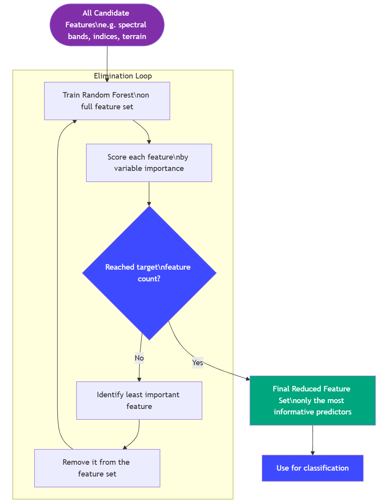

# Predictor Generation {#sec-module-5}

# Module Overview {.unnumbered}

The aim of Module 5 is to derive a set of predictors that optimize the discrimination of LULC classes in the classification model. Predictors are generated from three principal categories: spectral transformations (indices), terrain-based metrics, and distance-based metrics, capturing complementary spectral, topographic, and spatial information. These features are critical because raw spectral data alone often fail to adequately separate spectral or spatially similar classes, and their inclusion enhances model accuracy and robustness.

The module outputs a comprehensive predictor stack that serves as input for LULC map generation in Module 6.

# Input {.unnumbered}

| Name of Input | Input Type | Details |
|------------------------|------------------------|------------------------|
| supported spectral transformations | System’s input | Retrieve the pre-define function from existing library |
| Terrain-based metrics | System’s input |  |
| Distance-based metrics | System’s input |  |
| AOI | Input from Other Modules | Output from @sec-module-1 |
| Near-cloud free satellite imagery | Input from Other Modules | Output from @sec-module-1 |
| Sample data | Input from Other Modules | Output from @sec-module-3 |

# Output {.unnumbered}

Predictor/covariate/feature stack used in the classification model (Module 6)

# Process {.unnumbered}

## Predictor Availability Check and Selection {#sec-selection-of-predictors}

1.  The Luma GE supports various predictors that can be compute on the only, or manually uploaded by the user. The supported predictor categories are as follow:

    -   Spectral transformation

    -   Topographical data

    -   Distance from feature

    -   Radar Backscatter

2.  The user, manually select the predictor by using check boxes

3.  The system perform confirmation availability of user selected predictors by confirming sensor selection and temporal coverage

    ::: callout-tip
    ## Related Function

    `predictor.confirm_predictor_exist()` :
    :::

## Predictor Computation

1.  Topographical data

    -   **Elevation**: Refers to Digital Elevation Model (DEM) products, widely used in land cover classification framework. Several DEM is supported by Luma-GE, namely [NASADEM](https://developers.google.com/earth-engine/datasets/catalog/NASA_NASADEM_HGT_001?hl=id), [Copernicus GLO-30](https://developers.google.com/earth-engine/datasets/catalog/COPERNICUS_DEM_GLO30?hl=id#bands), and [ALOS DSM V4](https://developers.google.com/earth-engine/datasets/catalog/JAXA_ALOS_AW3D30_V4_1). The default optio is NASADEM since it provide improve vertical accuracy compared to other DEM product. All of the aforementioned DEM product have the spatial resolution of 30 m

    -   **Slope**: Calculated from selected DEM using `ee.Terrain.slope` function. Slope unit is presented in degree units (0-90)

    -   **Aspect**: Similar to slope, this data is calculated from the selected DEM, using `ee.Terrain.aspect`. The units are degree where 0=N, 90=E, 180=S, 270 =W

    ::: callout-tip
    ## Related Functions

    `predictor.terrain_calculator.calculate_elevation` : Core function to fetch DEM data from GEE catalog.

    `predictor.terrain_calculator.calculate_slope` : Core function to calculate slope from selected DEM data

    `predictor.terrain_calculator.calculate_aspect` : Core function to calculate aspect data from selected DEM data
    :::

2.  Distance-based metrics

    The system calculates distance from several features that might affect the presence of certain land cover class. The selection and distance calculation of these features are inspired by RESTORE+ project. Distances can be measured from various infrastructures, primarily roads, coastlines, and settlements.

    ::: callout-tip
    ## Related Functions

    `predictor.distance_calculator.calculate_distance_metrics`: Core function to initialize the distance calculation logic for coastline, road, and settlement

    predictor.get_predefine_distance
    :::

    Currently, the system support distance calculation from the following source:

    -   Coastline: [Natural Earth 10m coastline data](https://www.naturalearthdata.com/downloads/10m-physical-vectors/10m-coastline/),

    -   Settlement: [Facebook High Resolution Settlement Layer (HRSL)](https://dataforgood.facebook.com/dfg/tools/high-resolution-population-density-maps)

    -   Road: Indonesian Topographic Map (*Rupa Bumi Indonesia*) and OpenStreetMap

3.  Spectral transformation indices

    Luma utilize open-source [Awesome Spectral Indices](https://github.com/awesome-spectral-indices/spyndex) (ASI) library, a standardized, ready-to-use curated list of spectral indices that can be used as expressions for computing spectral indices in remote sensing applications. Therefore, manually defining the expression is not required. However, when adding a new index, it should be cross-reference with the availability of the index in the library. [Montero (2023)](https://doi.org/10.1038/s41597-023-02096-0) provide further reading regarding the formulation of the library as well as supported index. Currently, the supported index in Luma are as follows:

    -   Vegetation-related indices:

        -   NDVI (Normalized Difference Vegetation Index)

        -   EVI (Enhanced Vegetation Index)

        -   SAVI (Soil Adjusted Vegetation Index)

        -   MSAVI (Modified Soil Adjusted Vegetation Index)

        -   GNDVI (Green Normalized Difference Vegetation Index)

        -   MCARI1 (Modified Chlorophyll Absorption in Reflectance Index 1)

    -   Water-related indices:

        -   MNDWI (Modified Normalized Difference Water Index)

        -   ANDWI (Augmented Normalized Difference Water Index)

        -   NDMI (Normalized Difference Moisture Index)

        -   AWEInsh (Automatic Water Extraction Index with Shadow Elimination)

        -   NDTI (Normalized Difference Turbidity Index)

    -   Soil / built-up-related indices:

        -   NDBI (Normalized Difference Build-Up Index)

        -   DBSI (Dry Bareness Soil Index)

        -   MBI (Modified Build-up Index)

        -   BLFEI (Built-Up Land Feature Extraction Index)

    ::: callout-tip
    ## Related Functions

    `predictor.SpectralCalculator.get_avaliable_indices`: Return the list of supported indices. This list contain information regarding the Index name, long-name, formula, and references

    `predictor.SpectralCalculator.get_index_coefficients`: Get default coefficient values for a spectral index that needs user-define coefficients and parameters

    `predictor.SpectralCalculator.validate_coefficients`: Conducts checks the provided coefficients are within reasonable ranges and provides warnings for unusual values that might indicate errors.

    `predictor.SpectralCalculator.validate_index_requirements` : Validate that required bands are available for index computation.

    `predictor.SpectralCalculator.calculate_indices_with_collection`: Conducts calculation for each scene (image collection) and then aggregate the result using mean reducers. This logic is used to preserve phenological pattern of vegetation and other land features which ultimately loss during if the final image composite is used.

    `predictor.SpectralCalculator.get_calculation_summary` : provide summary of the calculation process of predictors
    :::

4.  Radar Backscatter

    Luma-GE supports Synthetic Aperture Radar (SAR) data as predictors for classification. Because radar observations are not affected by cloud cover, they can provide useful information in cloud-prone regions and complement optical imagery. The supported datasets are:

    -   Sentinel-1 C-Band Dual Polarization

        Sentinel-1 carries a dual-polarization C-band SAR instrument. In Google Earth Engine, the available data are Ground Range Detected (GRD) products processed with the Sentinel-1 Toolbox to produce calibrated, orthorectified imagery. Luma-GE converts the log-scaled digital number (DN) values to normalized backscatter values. The dataset is available from 2014, has a six-day revisit interval at the equator, and provides 10 m spatial resolution.

    -   ALOS PALSAR/PALSAR-2

        The Advanced Land Observing Satellite ([ALOS](https://www.earthdata.nasa.gov/data/platforms/space-based-platforms/alos "ALOS")) carries the Phased Array type L-band Synthetic Aperture Radar ([PALSAR](https://www.earthdata.nasa.gov/data/instruments/palsar "PALSAR")). The PALSAR record begins in 2007 and has 25 m spatial resolution. A gap in coverage between ALOS and ALOS-2 means that data are unavailable from 2011 to 2014. Luma-GE currently supports yearly PALSAR mosaics, with the latest coverage available from January 2024. PALSAR ScanSAR data are not supported because they require extensive preprocessing.

    Luma-GE does not currently apply the extensive preprocessing workflow described by [Mullissa et al. (2021)](https://github.com/adugnag/gee_s1_ard). The list of radar backscatter band for each sensor are as follow:

    1.  Sentinel-1

        -   VV: single co-polarization, vertical transmit/vertical receive

        -   VH: single co-polarization, vertical transmit/horizontal receive

        -   VV-VH Ratio: Ration between VV and VH polarization

    2.  ALOS PALSAR

        -   HH: single polarization, horizontal transmit/horizontal receive

        -   HV: single polarization, horizontal transmit/vertical receive

    ::: callout-note
    ## Related Function

    `predictor.get_radar_backscatter:`
    :::

    The main orchestration of predictor calculation is conduced after the system validate the required input. The system combines the additional predictors chosen from this module with the multispectral bands from Module 1.

    ::: callout-tip
    ## Related Functions

    `predictor.PredictorCalculation.validate_prerequisites:` Validate that required inputs are available for predictor computation. Required input are composite (`ee.Image`), AOI (`ee.FeatureCollection`) , and raw image collection (`ee.Image.Collection`)

    `predictor.PredictorCalculation.compute_predictors` : Initialize predictor computation by validating inputs, calculating selected terrain and spectral metrics, and stacking them into a final output.

    `predictor.PredictorCalculation.prepare_module6_summary:` Prepare summary metadata for module 6
    :::

## Predictors Visualization and Analysis

This section allow the user to visualize the resulted predictors to visually inspect the spatial distribution of the data.

1.  If the option to conduct correlation analysis was selected by the user, the system conduct correlation analysis using the following approach

    -   Creates a random sampling across the AOI (default value is 5000 points)

    -   Extract the pixel value of the computed predictors. The spectral band predictors are not extracted, since the analysis is design to analyze the correlation between ancillary predictors

    -   Computes correlation analysis using GEE's core function

2.  The correlation analysis is conducted across all predictors, including the original multispectral band

    ::: callout-tip
    ## Related Functions

    `predictor.EECorrelationAnalysis.generate_random_sampling`: Generate random sample across the AOI. Use default value of 5000 sample

    `predictor.EECorrelationAnalysis.compute_correlation`: Main function to compute Pearson correlation analysis based on the random samples generated. Return the panda data frame use for visualization.

    `predictor.EECorrelationAnalysis.visualize`: Visualize the correlation analysis result using heatmap
    :::

## Semi Automatic Predictor Selection Optimization

Evaluating the user's predictor selection is crucial step in determining the best combination of predictors that resulted in the optimal model performance. This approach is more commonly known as feature engineering in machine learning terminology. One of the commonly use feature engineering approach is Recursive Feature Elimination (RFE). RFE applied a backward step-wise selection process to find optimal combination of predictors based on its contribution to the model. The RFE starts with training the model with all input predictors and discards the weakest predictor one iteration at a time, while re-evaluating their importance after each removal. The workflow for RFE is shown in the figure below:

{fig-align="center" width="710"}

1.  The system perform input validation prior to RFE

    -   If the input is invalid, provide informative error messages. The invalid input includes missing data (training or testing) or missing ancillary predictors

    -   If the input is valid, proceed with RFE calculation

        ::: callout-tip
        ## Related Function

        `predictor.RfeGee.validate_inputs():`validate all input require for RFE calculations, namely: training data (`FeatureCollection`), test data (`FeatureCollection`), number of feature selected (\>1), and predictors (`ee.Image`)
        :::

2.  The system perform RFE with default configuration and report the optimal predictors to the user.

    -   the default configuration are as follow:

        -   Minimum feature to select: 10
        -   Minimum random forest tree: 100
        -   Training data (for RFE): 70% of user input
        -   Test data (for RFE): 30% of user input

    -   Since Earth Engine did not have default feature selection algorithm, the system create looping mechanism that train random forest classifier and return feature importance ranking and accuracy of the model for each iterations. The code is inspired by similar approach by [this github repository](https://github.com/DanGeospatial/GEE_Wetland_Classification)

        ::: callout-tip
        ## Related Function

        `predictor.RfeGee._train_classifier()` : core function to perform random forest classification with default configuration.

        `predictor.RfeGee._get_importance_and_accuracy()` :Retrieve feature importance test accuracy in a single round-trip to the Earth Engine servers. Optimizing the time required for finish the entire RFE.

        `predictor.RfeGee._adaptive_step()` : fallback mechanism to reduce API calls in case computational loads become larger.

        `predictor.RfeGee.fit()`: function to conduct the complete workflow for the entire RFE, including train classifier and calling importance and accuracy.
        :::

    -   To optimize API calls in Earth Engine servers, the calculations is conducted using server-side computations, and only called after all iterations is complete.

    -   The result of RFE is visualize using graphic and tables, including the selected features, rank of eliminations, and accuracy curve

        ::: callout-tip
        ## Related Function

        `predictor.RfeGee.get_selected_features` Function to retrieve optimal predictors list based on RFE result

        `predictor.RfeGee.get_ranking` Function to rank importance of each predictors

        `predictor.RfeGee.plot_accuracy_curve` Plot the accuracy curve as each features is remove from original input features

        `predictor.RfeGee.plot_feature_rankings` Plot the feature/predictor importance from RFE calculations

        `predictor.RfeGee.plot_rfe_summary` Create summary plot of accuracy curve and feature rankings

        `predictor.RfeGee.get_results_dataframe` Generate a dataframe of the corresponding accuracy and importance data
        :::

    -   Currently, the user require to determine the number of selected predictors for RFE. Future development will optimize this features