# 1 Map Generation {#sec-map-generation .unnumbered}

# Overview {.unnumbered}

In this workflow, the user produces a Land Use and Land Cover (LULC) map. Each step is presented as a panel on the left of the map canvas and progresses via the indicator at the top of the panel. To ensure usability regardless of technical know-how, user cannot skip steps; each step unlocks the next only after the required input has been provided by the user and the Geospatial Engine (GE) confirms the corresponding output has been produced and saved.

# Step 1: Basic Information {#sec-map-generation-basic-information}

**Overview**

Provides the inputs needed before any geospatial computation: where to map, when, and from which satellite imagery source.

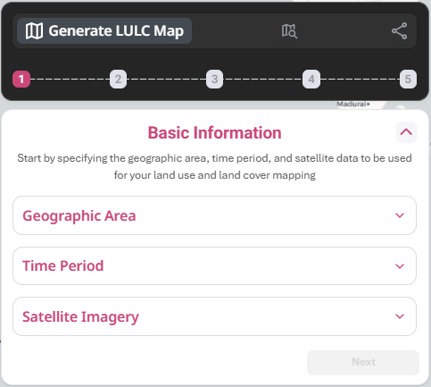

## Step 1.1: Geographic Area {#sec-map-generation-geographic-area}

**Overview**

This is the first required input in the Map Generation workflow where the user specify the geographic area they want to map by choosing one of three methods available: upload, draw area, or select an administrative boundary.

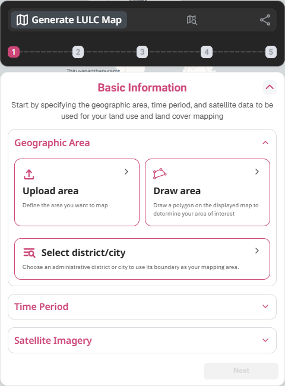

### Step 1.1.a: Upload Area

**Overview**

The user uploads a polygon file to define the geographic boundary of the area they want to map.

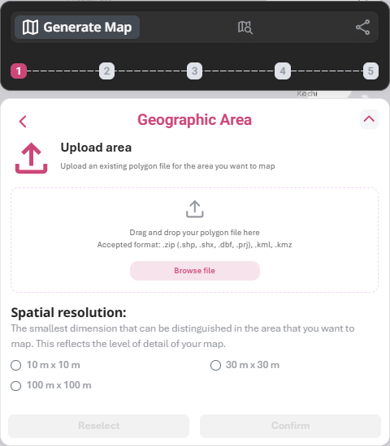

**Prerequisite to Occurring**

1.  The user clicks "Upload area".

**User Input to Interface**

1.  The user uploads their own AOI file in `.zip` format that should include all required shapefile components (`.shp`, `.shx`, `.dbf`, `.prj`). The system also supports uploads of `.kml` or `.kmz` files.

2.  The user chooses a spatial resolution from the selections (10 m x 10 m, 30 m x 30 m, 100 m x 100 m).

**Process**

1.  (Interface) The system checks the `.shp` or `.kml` inside the `.zip` file.

    **Input from User:** A polygon file in `.zip` format that includes all required shapefile components.

    **Outcome:** If shapefile components pass validation, continue to Process 2.

    ::: callout-important
    ## Error Handling Notification

    If the shapefile components do not match, an error warning is displayed: 'No `.shp` file found in the `.zip` file.’
    :::

2.  (Interface) The system retrieves AOI file information.

    **Outcome:** If all file information is correct, continue to Process 3.

    ::: callout-important
    ## Error Handling Notification

    If the file information cannot be found, an error warning is displayed: 'AOI not found’
    :::

3.  (Interface) The system retrieves AOI file area size information.

    **Outcome:** If the area size information is within the maximum area allowed, continue to Process 4.

    ::: callout-important
    ## Error Handling Notification

    If the area size information is bigger than 2,000,000 ha, an error warning is displayed: 'Draw area exceeds maximum limit (2,000,000 ha)’
    :::

4.  (GE) The system validates the geometry of the AOI for both `.shp` and `.kml` using [the `shapefile_validator` functions](@sec-validation-of-shapefile-geometries).

    **Input from Interface:** AOI for both `.shp` and `.kml` file formats.

    **Outcome:** If GIS file completeness is validated, continue to Process 5.

    ::: callout-important
    ## Error Handling Notification

    If validation failed, an error warning is displayed: 'Geometry validation failed.'
    :::

5.  (Interface) The system returns the validated and processed shapefile.

    **Input from GE:** Validated and processed shapefile.

    **Outcome:**

    ::: callout-note
    ## Success Notification

    The system shows a confirmation when the AOI is loaded successfully by showing a purple box with 'Approximate size of your mapping area: X \[number\] Ha' displayed
    :::

6.  (Interface) The system activates the next step.

    **Input from User:** A spatial resolution selection (10 m x 10 m, 30 m x 30 m, 100 m x 100 m).

    **Input from GE:** Validated and processed shapefile.

    **Outcome:** "Confirm" button activated.

7.  (Interface) The uploaded file is deleted.

    **Input from User:** The user clicks "Reselect area".

    **Outcome:** All inputs are being reset, the user will be redirected to @sec-map-generation-basic-information.

### Step 1.1.b: Draw Area

**Overview**

The user draws their area of interest directly on the map by creating borders of area they want to map. Each click adds a new side/edge (vertex) to the polygon, with a double-click to finish drawing and close the polygon. This is useful when the user does not have a prepared polygon file or wants to quickly define a simple area.

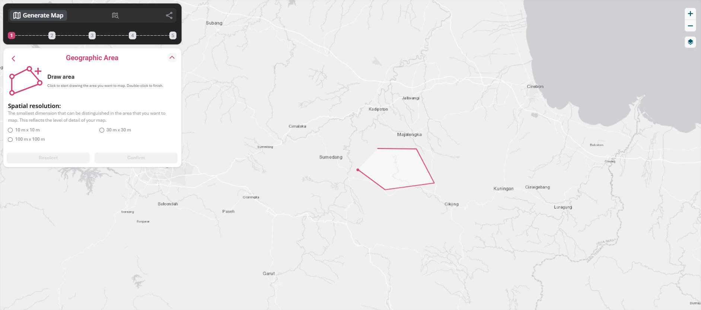

**Prerequisite to Occurring**

1.  The user clicks "Draw area".

**User Input to Interface**

1.  The user creates a series of clicks on the map to create a polygon.

2.  The user chooses a spatial resolution from the selections (10 m x 10 m, 30 m x 30 m, 100 m x 100 m).

**Process**

1.  (Interface) The system retrieves the AOI area size information.

    **Input from User:** A series of clicks on the map to create a polygon.

    **Outcome:**

    ::: callout-note
    ## Success Notification

    The system shows a confirmation when the AOI is loaded successfully by showing a purple box with 'Approximate size of your mapping area: X \[number\] Ha' displayed
    :::

    ::: callout-important
    ## Error Handling Notification

    If the area size information is bigger than 2,000,000 ha, an error warning is displayed: 'Draw area exceeds maximum limit (2,000,000 ha)’
    :::

2.  (Interface) The system activates the next step.

    **Input from User:** A spatial resolution selection (10 m x 10 m, 30 m x 30 m, 100 m x 100 m).

    **Input from GE:** Validated and processed shapefile.

    **Outcome:** The "Confirm" button is activated.

3.  (Interface) The drawn polygon is deleted.

    **Input from User:** The user clicks "Reselect area".

    **Outcome:** All inputs are being reset, the user will be redirected to @sec-map-generation-basic-information.

### Step 1.1.c: Administrative Boundaries

**Overview**

The user selects the area they want to map based on a drop down list of Indonesian regency administrative boundaries. Disclaimer about the data source (Badan Informasi Geospasial) is included with the data uploaded as GEE asset and the link provided and shared publicly. The system provides a preview of the selected boundary.

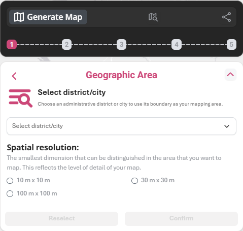

**Prerequisite to Occurring**

1.  The user clicks “Select district/city”.

**User Input to Interface**

1.  The user selects an AOI based on a drop down list of Indonesian regency administrative boundaries.

2.  The user chooses a spatial resolution from the selections (10 m x 10 m, 30 m x 30 m, 100 m x 100 m).

**Process**

1.  (GE) The system loads the related functions in @sec-aoi-from-administrative-boundary containing Indonesian administrative boundaries from Badan Informasi Geospasial and extracts the regency name and provide complete list of the available regencies for the user.

    **Input from Interface:** "Select district/city" is selected in @sec-map-generation-geographic-area.

    **Outcome:** List of regency/city names provided to the interface for drop down list.

2.  (Interface) The system retrieves the AOI information from the selected administrative boundary selections.

    **Input from User:** An administrative boundary selected by the user.

    **Outcome:** Provide name of selected administrative boundary to Process 3.

3.  (GE) The system converts selected polygon from @sec-aoi-from-administrative-boundary for visualization.

    **Input from Interface:** Name of selected administrative boundary

    **Outcome:** The system provides a preview of the selected boundary on the map canvas.

4.  (Interface) The system activates the next step.

    **Input from User:** A spatial resolution selection (10 m x 10 m, 30 m x 30 m, 100 m x 100 m).

    **Input from GE:** Selected administrative polygon from Process 2.

    **Outcome:** "Confirm" button activated.

5.  (Interface) The selected administrative polygon is deleted.

    **Input from User:** The user clicks "Reselect area".

    **Outcome:** All inputs are being reset, the user will be redirected to Process 1.

## Step 1.2: Time Period {#sec-map-generation-time-period}

**Overview**

The user defines the time period for the land use and land cover map. Currently available options for time interval of the satellite imagery period are limited to yearly (a single year) or custom date range.

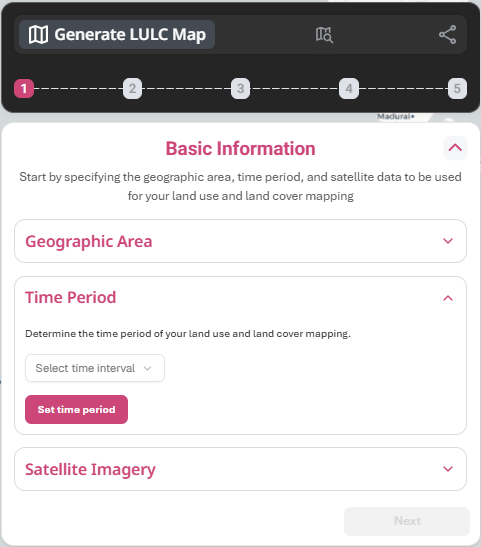

**User Input to Interface**

1.  The user selects the time interval they want to use (yearly or custom date range).

2.  The user further specifies the period by selecting the year (if yearly) or entering the start and end dates (if custom date range) that they want to map.

**Process**

1.  (Interface) The system provides input fields to specify time period based on selected time interval.

    **Input from User:** A time interval selection ("By year" or ”Custom date range”).

    **Outcome 1:** If "By year": The system shows the year selections from 1972 until current year in a form of a drop down list.

    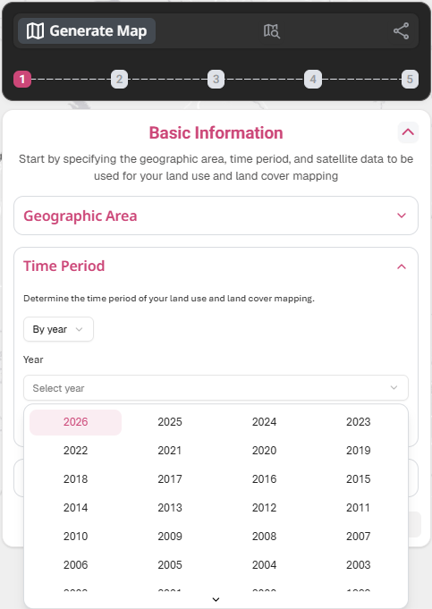

    **Outcome 2:** If "Custom date range": The system provides calendar display to allow user choose specific start and end dates.

    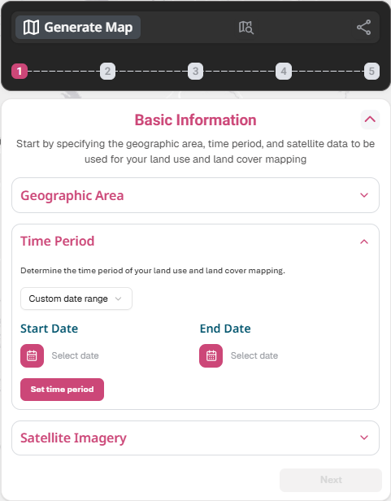

2.  (Interface) The system activates "Set time period" button.

    **Input from User:** A year selection (1972–current year) or specific start and end dates.

    **Outcome:** "Set time period" button activated.

3.  (Interface) The system confirms the time period input.

    **Input from User:** The user clicks "Set time period" button.

    **Outcome:**

    - The system shows a confirmation by showing a purple box with a summary of: time interval, period, satellite imagery date range selected.
    - A clickable "Change input" text also appears.

4.  (Interface) The system resets all input from @sec-map-generation-time-period.

    **Input from User:** The user clicks "Change input" button.

    **Outcome:** The user is brought back to the beginning of @sec-map-generation-time-period.

## Step 1.3: Satellite Imagery {#sec-map-generation-satellite-imagery}

**Overview**

The user confirms default selection for satellite imagery source and the maximum cloud coverage percentage or click change input to customize final input to the basic information.

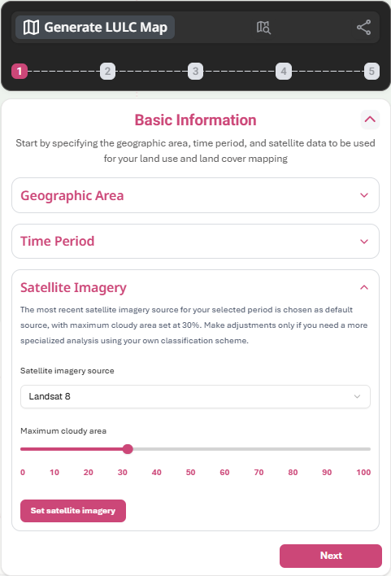

**Prerequisite to Occurring**

1.  Landsat only available for the spatial resolution of 30 m x 30 m and 100 m x 100 m chosen in Step 1.1.

2.  Sentinel-2 only available for the spatial resolution of 10 m x 10 m chosen in Step 1.1.

3.  Sentinel-2 only available for the time period after the year 2015 chosen in Step 1.2.

**User Input to Interface**

1.  Most recent available satellite imagery source and 30% maximum cloudy area are chosen as default input. User is provided with the option to "Change input". If chosen, user can input 2 and 3 below.

2.  The user selects the satellite imagery source from a drop down list.

3.  The user selects the maximum cloudy area by dragging the slider to the desired number.

**Process**

1.  (Interface) The system adjusts default satellite imagery source and other options according to time period input in @sec-map-generation-time-period.

    **Input from User:** A selected year or date range in @sec-map-generation-time-period.

    **Outcome:** The most recent available satellite imagery source is chosen as default, with the other options available in the drop down list.

2.  (Interface) The system provides satellite imagery input fields.

    **Input from User:** The user clicks "Change input" button.

    **Outcome:** The system replaces summary box with input fields:

    - satellite imagery source drop down

    - cloudy area slider

    - activated set satellite imagery button

3.  (Interface) The system confirms changed input.

    **Input from User:**

    - The user inputs value for satellite imagery source and/or cloudy area percentage.

    - The user clicks "Set satellite imagery" button.

    **Outcome:** Satellite imagery input summary is displayed in a purple box showing satellite imagery source and maximum cloudy area.

4.  (Interface) The system checks that all input from @sec-map-generation-geographic-area to @sec-map-generation-satellite-imagery has been provided as condition to activate the “Next” button.

    **Input from User:** All user input required in @sec-map-generation-geographic-area to @sec-map-generation-satellite-imagery.

    **Outcome 1:** The “Next” button is activated when all input fields are filled.

    **Outcome 2:** The “Next” button remains deactivated when not all inputs are filled.

## Step 1.4: Confirm and Preview

**Overview**

After all input to basic information have been finalized, user is presented with summary of input for final confirmation. User confirms through clicking "View satellite imagery" which will trigger the system to retrieve all available scenes, removes cloudy pixels, and combines the rest into a single cloud-free composite image. This composite is the base image for all classification steps. Three visualisation modes are generated: True Colour (RGB), False Colour Infrared, and Land/Water.

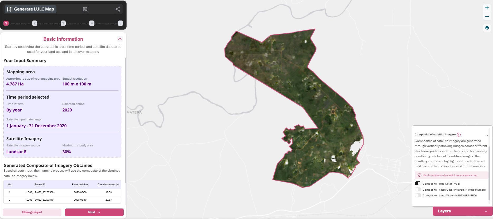

**Prerequisite to Occurring**

1.  The user completed @sec-map-generation-geographic-area to @sec-map-generation-satellite-imagery.

**User Input to Interface**

1.  The user clicks "Next" to confirm summary of all inputs after @sec-map-generation-satellite-imagery.

2.  The user clicks "View satellite imagery" to initiate processing of satellite imagery.

**Process**

1.  (Interface) The system summarizes the basic information from previous steps.

    **Input from GE:** Collected basic information from previous steps.

    **Outcome:** The user’s input summary is displayed in a purple box, showing:

    - Mapping area: approximate size of your mapping area
    - Time period selected: time interval, selected period, satellite input date range
    - Satellite imagery: satellite imagery source, maximum cloudy area

    Two buttons appear:

    - "Change Input"; continue to Process 2
    - "View Satellite Imagery"; continue to Process 3

    ::: callout-important
    ## Error Handling Notification

    The system provides an error notification if no satellite images were found based on the user’s parameter. The user is prompted to change the cloud cover threshold or change the time period.
    :::

2.  (Interface) The system specifies where to change input.

    **Input from User:** The user clicks on one of the "Edit" (pencil icon) buttons that appear next to each of the input summary’s heading.

    **Outcome:** The user will go back to the corresponding step for input of basic information with previous input displayed. Once the "Edit" (pencil) button is clicked, a pop up window appeared for user to choose to "Change Input" or "Discard Changes".

3.  (Interface) The system processes the satellite image request.

    **Input from User:** The user clicks on the "View Satellite Imagery" button.

    **Input from GE:** Collected satellite image information.

    **Outcome:**

    - A table of Generated Composite of Imagery Obtained appeared under the User’s Input Summary along with Cloud Coverage Statistic.

    - Composite of satellite imagery appears on the base map, with default setting of true color (RGB).

    - Layers option appears on the bottom right corner of the screen, includes:

      - Mapping area; with polygon toggle

      - Composite of satellite imagery; with true color (RGB), false color infrared (NIR/Red/Green), land/water (NIR/SWIR1/RED) toggle options

      - LULC class; still disabled in this step

    - The user can then download the composite, leading to Process 5.

    - "Next" button appears, which leads to @sec-map-generation-lulc-classification.

4.  (GE) The system performs pre-processing functions to generate an analysis-ready satellite images and collects information on satellite image availability shows the number of total satellite images found based on the user parameter input. The information includes total images found, date range of images, WRS tiles, path row tiles, scene IDs, image acquisition dates, average scene cloud cover, date range, and cloud cover range.

    **Input from Interface:** Selected sensor image and cloud cover threshold.

    **Outcome:** When all information is collected, allowed to continue to Process 5.

    ::: callout-important
    ## Error Handling Notification

    The system provides an error notification if no satellite images were found based on the user’s parameter. The user is prompted to change the cloud cover threshold or change the target map date.
    :::

5.  (Interface) The system downloads a `.zip` file containing satellite image composite.

    **Input from User:** The user downloads composite.

    **Outcome:** A `.zip` file containing satellite image composite is downloaded to user's local device.

# Step 2: Land Use and Land Cover Classification {#sec-map-generation-lulc-classification}

**Overview**

The user defines the land use and land cover classes that will be mapped. There are two main options: using the built-in Luma default classification scheme or uploading a custom classification scheme. The selected classes determine which training data will be used in the next step. The Epistem-AI feature will also be available here.

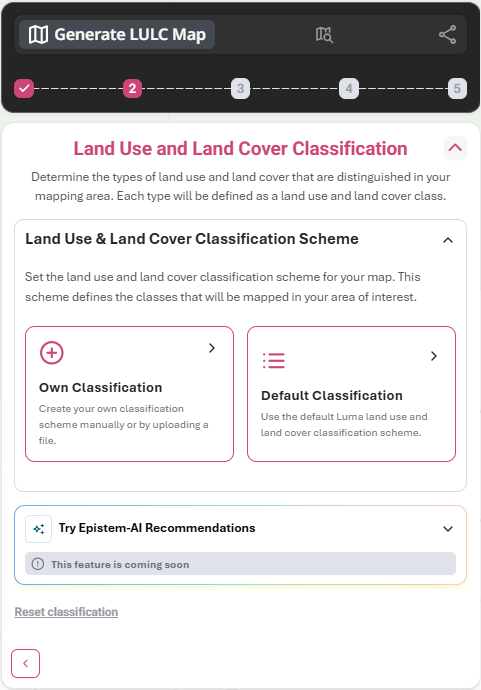

## Step 2.a: Land Use & Land Cover Classification Scheme {#sec-map-generation-lulc-classification-2a}

**Overview**

Luma supports user-defined classification schemes and default classification or templates for commonly used classification schemes.

### Step 2.a.a: Own Classification

**Overview**

The user creates their own classification scheme manually or by uploading a file.

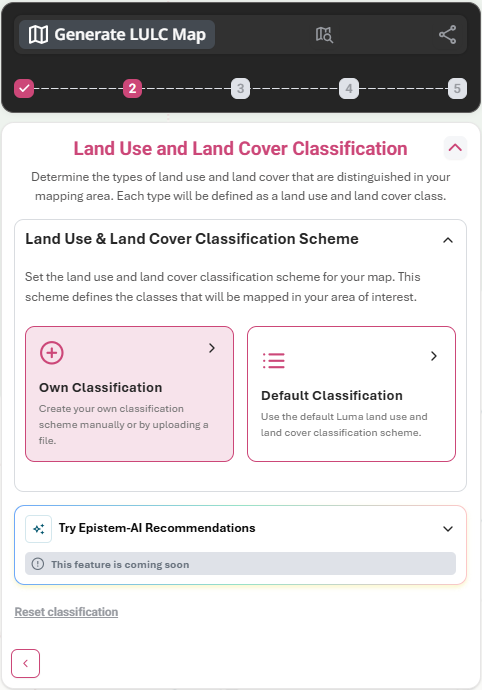

**Prerequisite to Occurring**

1.  The user clicks “Own Classification”.

**User Input to Interface**

1.  The user clicks “Own Classification” to create their own classification scheme.

**Process**

1.  (Interface) The system shows two options within the "Own Classification" window: "Manual Input" and "Upload Classes".

    **Input from User:** The user clicks "Own Classification".

    **Outcome:** "Manual Input" and "Upload Classes" panels are activated.

#### Step 2.a.a.a: Manual Input {#sec-map-generation-manual-input}

**Overview**

The user inputs the land use and land cover classes they want to map. They need to type a class name and optionally pick a colour for each class.

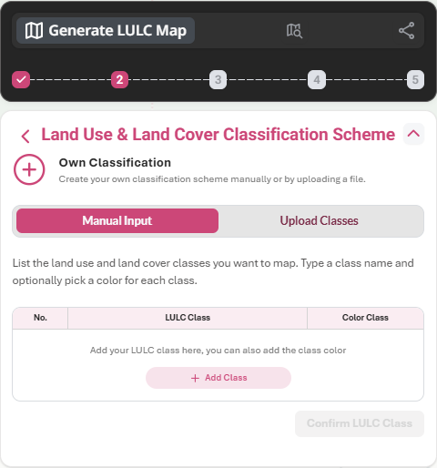

**Prerequisite to Occurring**

1.  The user clicks “Manual Input”.

**User Input to Interface**

1.  The user clicks "Add Class" button.

2.  The user fills out LULC class name and selects class color.

**Process**

1.  (Interface) The system shows a table with No., LULC Class, and Class Color columns.

    **Input from User:** The user clicks "Add Class" button.

    **Outcome:** The LULC Class column is editable and 28 color options in Class Color column is activated.

2.  (Interface) The system stores each class entry individually as it is added.

    **Input from User:** The user enters LULC class name and pick a color out of 28 color options.

    **Outcome:** Continue to Process 3.

3.  (GE) The system validates class ID, name, and checks for uniqueness with the functions in @sec-user-entering-the-classification-manually.

    **Input from Interface:** A list of class and color entries

    **Outcome:** If validation is correct, continue to Process 4.

4.  (Interface) The system summarizes all input.

    **Input from GE:** Validated class IDs, classes and colors.

    **Outcome:**

    - All added classes are displayed in the class recorded table for preview
    - Upload Classes option still available; if clicked, continue to @sec-map-generation-upload-classes Process 1
    - Confirm LULC Class enabled; once clicked, all inputs are locked and a summary table is previewed, along with three options:
      - "Edit" (pencil icon); continue to Process 5
      - "Download LULC classes (CSV)"; a `.csv` file containing the inputted classification scheme is downloaded to user’s local device.
      - "Next"; continue to Process 8

    ::: callout-important
    ## Error Handling Notification

    The system returns a validity flag with an error message if invalid
    :::

5.  (Interface) The system shows Edit mode.

    **Input from User:** The user edits or deletes the classes in the summary table preview.

    **Outcome:** Continue to Process 6.

6.  (GE) The system validates input, assigns colors, sorts classes, and updates the next available ID by running the functions in @sec-user-entering-the-classification-manually.

    **Input from Interface:** New class or color updates.

    **Outcome:** If validation is correct, continue to Process 7.

7.  (Interface) The system summarizes all input.

    **Input from GE:** New validates class IDs, classes, and colors.

    **Outcome:**

    - Each class row can be edited individually
    - New classes can be added with Add Class button
    - If all classes are deleted, back to the beginning of @sec-map-generation-lulc-classification
    - "Done" button appears; if clicked:
      - "Next" button appears; continue to Process 6
      - "Download LULC classes (CSV)" appears; a `.csv` file containing the inputted classification scheme is downloaded to user’s local device

    ::: callout-important
    ## Error Handling Notification

    The system returns a validity flag with an error message if invalid
    :::

8.  (Interface) The system saves all input and process to the next step.

    **Input from User:** The user clicks on the "Next" button.

    **Outcome: T**he user will be directed to @sec-map-generation-sample-data.

9.  (Interface) The system saves all input.

    **Input from User:** The user clicks on the "Back" (chevron) button

    **Outcome:** The panel of @sec-map-generation-satellite-imagery Process 3 is being shown. The user has to click the "Next" button to go back to the last edited panel in @sec-map-generation-lulc-classification.

#### Step 2.a.a.b: Upload Classes {#sec-map-generation-upload-classes}

**Overview**

The user downloads a classification template `.csv` file and uses it to list the land use and land cover classes they want to map. After filling the template, they need to upload the file to be used as the custom classification scheme.

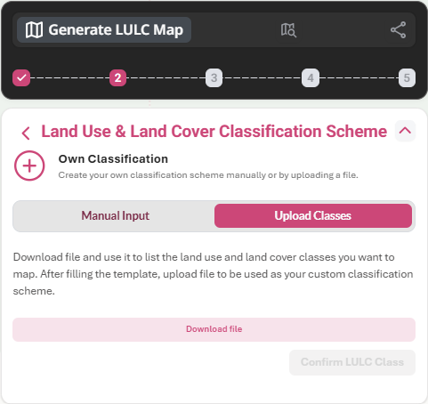

**Prerequisite to Occurring**

1.  The user clicks “Upload Classes”.

**User Input to Interface**

1.  The user clicks "Upload Classes" button.

2.  The user uploads the `.csv` file containing the classification scheme information containing at least three columns: a class ID (numeric identifier), a class name, and an optional hex colour code specifying the display colour for each class.

**Process**

1.  (Interface) The panel changed into Browse file for the user to upload the filled `.csv` file.

    **Input from User:** The user downloads the `.csv` file containing the classification scheme information template.

    **Outcome:** A `.csv` file containing classification scheme information template is downloaded to user’s local device.

2.  (Interface) The system stores the file uploaded.

    **Input from User:** The user uploads the `.csv` file containing the classification scheme information by browsing file or drag and drop the file.

    **Outcome:** Continue to Process 3.

3.  (GE) The system runs the functions in @sec-user-uploading-their-own-classification to automatically detects the column headers.

    **Input from Interface:** `.csv` file containing the classification scheme information.

    **Outcome:** Continue to Process 4.

4.  (GE) The system performs several validation functions to the uploaded `.csv` to ensure IDs are numeric and unique, applies a set of distinct colors if no color code was provided by the user.

    **Input from Interface:** Column headers of the`.csv` file are detected.

    **Outcome:** Continue to Process 5.

5.  (Interface) The system summarizes all input.

    **Input from GE:** Validated `.csv` file.

    **Outcome:** If the classification scheme file successfully uploaded:

    - A purple box indicating the uploaded file with its file size appears

    - A summary table of recorded classes with its ID number and colour class appears

    - Manual Input option still available; if clicked, continue to @sec-map-generation-manual-input Process 2

    - Confirm LULC Class enabled, if clicked, a summary table is previewed, along with three options:

      - "Edit" (pencil icon); continue to Process 6
      - "Download LUCL classes (CSV)"; a `.csv` file containing the inputted classification scheme is downloaded to user’s local device.
      - "Next"; continue to Process 7

    ::: callout-important
    ## Error Handling Notification

    The system returns a validity flag with an error message if:

    - The class ID is not a valid number.

    - There is a duplicate class ID.
    :::

6.  (Interface) The system shows that the user is in "Edit mode" with a line of direction and a "Done" button. "Rubbish bin" icons are next to color class column, each LULC class and color class cell can be edited.

    **Input from User:** The user clicks on the "Edit" button

    **Outcome:** Each cell can be edited individually. The uploaded file can be deleted, if clicked, all inputs are being reset, back to the beginning of @sec-map-generation-lulc-classification.

7.  (Interface) The system saves all input.

    **Input from User:** The user clicks on the "Next" button

    **Outcome:** The user will be directed to @sec-map-generation-sample-data.

8.  (Interface) Th system saves all input.

    **Input from User:** The user clicks on the "Back" (chevron) button.

    **Outcome:** The panel of @sec-map-generation-satellite-imagery Process 3 is being shown. The user has to click the "Next" button to go back to the last edited panel in @sec-map-generation-lulc-classification.

### Step 2.a.b: Default Classification {#sec-map-generation-default-classes}

**Overview**

The user activates class options from default Luma land use and land cover classification scheme. The user is given the option to choose only a specific subset of the default classes, rather than being required to utilize the entire set.

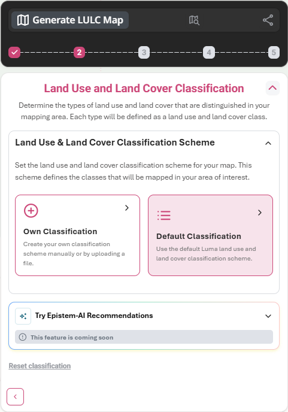

**Prerequisite to Occurring**

1.  The user chose 100 m x 100 m spatial resolution in @sec-map-generation-geographic-area.

2.  The user clicks “Default Classification”.

**User Input to Interface**

1.  The user clicks “Default Classification” to use Epistem classification scheme.

2.  The user selects LULC classes from the existing classification scheme.

**Process**

1.  (Interface) The system shows subsets of Vegetation and Non-vegetation classes.

    **Input from User:** The user clicks "Default Classification".

    **Outcome:** Subsets of the default classes are activated.

2.  (Interface) The classification table is being saved to the system.

    **Input from User:** The user selects subsets of the default classes.

    **Outcome:** "Confirm LULC Class" button is activated.

3.  (GE) The system loads the selected classes from a dataset by running functions in @sec-user-select-existing-lulc-template.

    **Input from Interface:** Selected classification scheme classes.

    **Outcome:** The system shows a confirmation if the classification table is successfully saved to the system.

4.  (Interface) The system summarizes all input.

    **Input from GE:** Confirmed classification table.

    **Outcome:**

    - A summary table of recorded classes with its ID number and color class appears
    - Two buttons appear:
      - "Reset classification"; continue to Process 5
      - "Next"; continue to Process 6

5.  (Interface) All inputs are being reset.

    **Input from User:** The user clicks on "Reset classification".

    **Outcome:** Back to the beginning of @sec-map-generation-lulc-classification.

6.  (Interface) The system saves all input and process the next step.

    **Input from User:** The user clicks on the "Next" button.

    **Outcome:** The user will be directed to @sec-map-generation-sample-data.

7.  (Interface) The system saves all input.

    **Input from User:** The user clicks on the "Edit" button.

    **Outcome:** The user will be directed to Process 2 with the selected classes toggles activated.

8.  (Interface) The system saves all input.

    **Input from User:** The user clicks on the "Back" (chevron) button.

    **Outcome:** The panel of @sec-map-generation-satellite-imagery Process 3 is being shown. The user has to click the "Next" button to go back to the last edited panel in @sec-map-generation-lulc-classification.

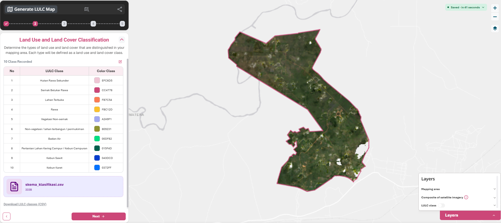

## Step 2.b: Try Epistem-AI Recommendations

**Overview**

This feature is coming soon.

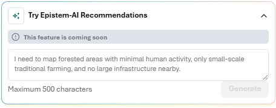

# Step 3: Mapping Sample Data {#sec-map-generation-sample-data}

**Overview**

The user prepares the sample data for land use and land cover classification in their mapping area. The user can upload existing data or create samples directly in Luma through on-screen sampling. In this step the Sample Data Summary selected in the previous step is also shown. The spectral separability of LULC classes is also being assessed in this step using sample data and near-cloud-free satellite imagery. Pairwise class separability is quantified using the Transformed Divergence (TD) method based on pixel-level spectral statistics, using only the spectral data from @sec-map-generation-basic-information.

## Step 3.a: Upload Sample Data {#sec-map-generation-upload-sample-data}

**Overview**

The user uploads their existing sample data in `.zip` file format.

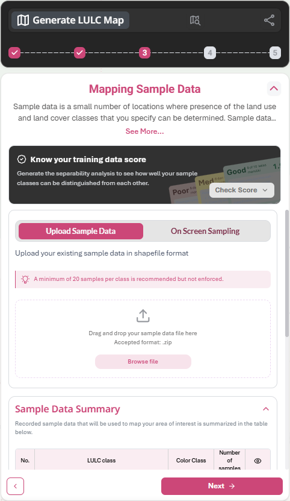

**Prerequisite to Occurring**

1.  The user chose "Own Classification" in @sec-map-generation-lulc-classification-2a.

2.  The user clicks “Upload Sample Data”.

**User Input to Interface**

1.  The user uploads a `.zip` file containing their sample data.

**Process**

1.  (Interface) The system checks if there are any `.shp` file inside the `.zip` file.

    **Input from User:** The user uploads the `.zip` file containing the sample data.

    **Outcome:** Continue to Process 2.

2.  (GE) The system checks if there are any `.shp` file inside the `.zip` file by running the functions in @sec-user-upload-their-own-training-data.

    **Input from Interface:** `.shp` sample data inside the `.zip` file.

    **Outcome:** The system shows a confirmation if the sample data is successfully verified. Continue to Process 3.

    ::: callout-important
    ## Error Handling Notification

    The system provides an error notification if the system fails to conduct the sample data verification, along with the specific message at which step the validation failed
    :::

3.  (Interface) The system returns the preview of the uploaded sample data on the map canvas and table of the uploaded sample data.

    **Input from GE:** Verified sample data.

    **Outcome:**

    - A purple box indicating the uploaded file with its file size appears with a delete button, if clicked, continue to the beginning of @sec-map-generation-sample-data.
    - A summary table of Sample Data Summary with ID number, LULC class name, color class, number of samples, and buttons to view each class appears.

4.  (Interface) The system provides a selection for Spatial Resolution (m) and Maximum Pixels Per Class. The default value is 100 m and 5000 pixels.

    **Input from User:** The user clicks on the "Check Score" button to know their sample data quality.

    **Outcome:** Continue to Process 5.

5.  (GE) The system conducts the separability analysis by running the functions in @sec-module-4.

    **Input from Interface:** Verified `.zip` file.

    **Outcome:** The system displays a highlight of separability category (good, weak, or poor) for each class, and highlights which LULC classes require improvement. A data frame containing details of the pairwise separability is also displayed. Continue to Process 6.

6.  (Interface) The system returns the sample data quality result.

    **Input from GE:** Sample data quality analysis result.

    **Outcome:**

    - Training Data Quality result appears, with its category (good, weak, or poor) for each class, and highlights which LULC classes require improvement. A data frame containing details of the pairwise separability is also displayed.
    - The user can choose several paths:
      - Delete the uploaded file; all input in @sec-map-generation-upload-sample-data is deleted and continue to the beginning of @sec-map-generation-sample-data
      - On Screen Sampling:
        - Single Point Input; continue to @sec-map-generation-single-point
        - Bulk Point Input; continue to @sec-map-generation-bulk-point
      - Next; continue to @sec-map-generation-parameters

7.  (Interface) The system provides a selection for Spatial Resolution (m) and Maximum Pixels Per Class. The default value is 100 m and 5000 pixels.

    **Input from User:** The user clicks on the "Recheck Score" button.

    **Outcome:** Continue to Process 5.

8.  (Interface) The system saves all input.

    **Input from User:** The user clicks on the "Back" (chevron) button.

    **Outcome:** The panel of @sec-map-generation-lulc-classification summary table of recorded classes is being shown. The user has to click the "Next" button to go back to the last edited panel in @sec-map-generation-sample-data.

## Step 3.b: On Screen Sampling {#sec-map-generation-oss}

**Overview**

The user adds points or draws polygons directly on the interactive displayed map for all land use and land cover classes in their mapping area.

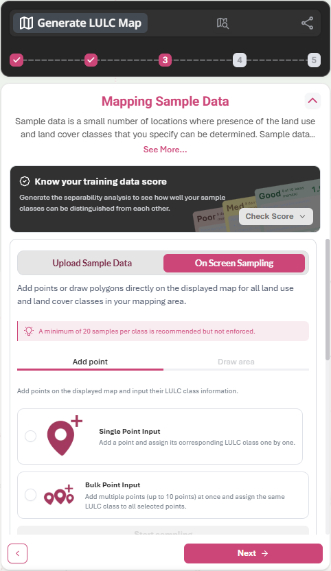

**Prerequisite to Occurring**

1.  The user clicks “On Screen Sampling”.

### Step 3.b.a: Add Point

**Overview**

The user adds points on the interactive displayed map and input their land use and land cover class information.

**Prerequisite to Occurring**

1.  The user chose "Own Classification" in @sec-map-generation-lulc-classification-2a.

#### Step 3.b.a.a: Single Point Input {#sec-map-generation-single-point}

**Overview**

The user adds a point and assigns its corresponding land use and land cover class one by one from the drop down list.

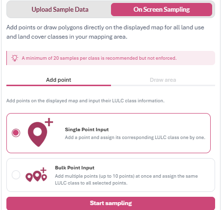

**Prerequisite to Occurring**

1.  The user clicks “Single Point Input”.

**User Input to Interface**

1.  The user assigns new sample points one by one accordingly to the correct class.

**Process**

1.  (Interface) The system shows a confirmation that the pinned points have been loaded to the on-screen canvas, along with the number of sample data on the Summary Table.

    **Input from User:** The user assigns a sample point on the map accordingly to the correct class from the drop down list.

    **Outcome:**

    - The number of samples in the Summary Table increased based on the user’s inputs.
    - "End Pointing" button enabled; if clicked, continue to Process 2.

2.  (Interface) The system saves all input.

    **Input from User:** The user clicks on "End Pointing" button.

    **Outcome:** The user is redirected to @sec-map-generation-oss with Sample Data Summary table and "Training Data Score Check" button enabled.

3.  (Interface) The system provides a selection for Spatial Resolution (m) and Maximum Pixels Per Class. The default value is 100 m and 5000 pixels.

    **Input from User:** The user clicks on the "Check Score" button to know their sample data quality.

    **Outcome:** Continue to Process 4.

4.  (GE) The system conducts the separability analysis by running the functions in @sec-module-4.

    **Input from Interface:** Sampe dataset.

    **Outcome:** The system displays a highlight of separability category (good, weak, or poor) for each class, and highlights which LULC classes require improvement. A data frame containing details of the pairwise separability is also displayed. Continue to Process 5.

5.  (Interface) The system returns the sample data quality result.

    **Input from GE:** Sample data quality analysis result.

    **Outcome:**

    - Training Data Quality result appears, with its category (good, weak, or poor) for each class, and highlights which LULC classes require improvement. A data frame containing details of the pairwise separability is also displayed.
    - The user can choose several paths:
      - Delete the uploaded file; all input in @sec-map-generation-upload-sample-data is deleted and continue to the beginning of @sec-map-generation-sample-data
      - On Screen Sampling:
        - Single Point Input; continue to @sec-map-generation-single-point
        - Bulk Point Input; continue to @sec-map-generation-bulk-point
      - Upload Sample Data; continue to @sec-map-generation-upload-sample-data
      - Next; continue to @sec-map-generation-parameters

6.  (Interface) The system provides a selection for Spatial Resolution (m) and Maximum Pixels Per Class. The default value is 100 m and 5000 pixels.

    **Input from User:** The user clicks on the "Recheck Score" button.

    **Outcome:** The user is redirected to Process 4.

7.  (Interface) The system saves all input.

    **Input from User:** The user clicks on the "Back" (chevron) button.

    **Outcome:** The panel of @sec-map-generation-lulc-classification summary table of recorded classes is being shown. The user has to click the "Next" button to go back to the last edited panel in @sec-map-generation-sample-data.

#### Step 3.b.a.b: Bulk Point Input {#sec-map-generation-bulk-point}

**Overview**

The user adds multiple points (up to 10 points) at once and assigns the same land use and land cover class to all selected points.

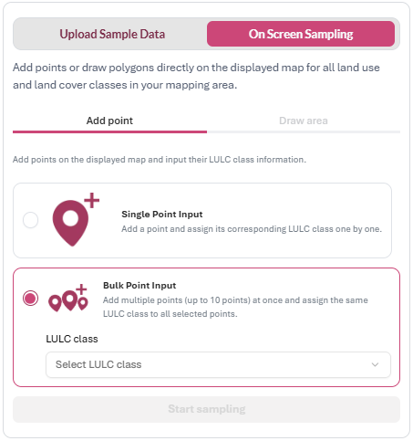

**Prerequisite to Occurring**

1.  The user clicks “Bulk Point Input”.

**User Input to Interface**

1.  The user assign new sample points accordingly to the one class at a time.

**Process**

1.  (Interface) The system shows a confirmation that the pinned points have been loaded to the on-screen canvas, along with the number of sample data on the Summary Table.

    **Input from User:** The user assigns a sample point on the map accordingly to the correct class from the drop down list.

    **Outcome:**

    - The number of samples in the Summary Table increased based on the user’s inputs.
    - "End Pointing" button enabled; if clicked, continue to Process 2.

2.  (Interface) The system saves all input.

    **Input from User:** The user clicks on "End Pointing" button.

    **Outcome:** The user is redirected to @sec-map-generation-oss with Sample Data Summary table and "Training Data Score Check" button enabled.

3.  (Interface) The system provides a selection for Spatial Resolution (m) and Maximum Pixels Per Class. The default value is 100 m and 5000 pixels.

    **Input from User:** The user clicks on the "Check Score" button to know their sample data quality.

    **Outcome:** Continue to Process 4.

4.  (GE) The system conducts the separability analysis by running the functions in @sec-module-4.

    **Input from Interface:** Sampe dataset.

    **Outcome:** The system displays a highlight of separability category (good, weak, or poor) for each class, and highlights which LULC classes require improvement. A data frame containing details of the pairwise separability is also displayed. Continue to Process 5.

5.  (Interface) The system returns the sample data quality result.

    **Input from GE:** Sample data quality analysis result.

    **Outcome:**

    - Training Data Quality result appears, with its category (good, weak, or poor) for each class, and highlights which LULC classes require improvement. A data frame containing details of the pairwise separability is also displayed.
    - The user can choose several paths:
      - Delete the uploaded file; all input in @sec-map-generation-upload-sample-data is deleted and continue to the beginning of @sec-map-generation-sample-data
      - On Screen Sampling:
        - Single Point Input; continue to @sec-map-generation-single-point
        - Bulk Point Input; continue to @sec-map-generation-bulk-point
      - Upload Sample Data; continue to @sec-map-generation-upload-sample-data
      - Next; continue to @sec-map-generation-parameters

6.  (Interface) The system provides a selection for Spatial Resolution (m) and Maximum Pixels Per Class. The default value is 100 m and 5000 pixels.

    **Input from User:** The user clicks on the "Recheck Score" button.

    **Outcome:** The user is redirected to Process 4.

7.  (Interface) The system saves all input.

    **Input from User:** The user clicks on the "Back" (chevron) button.

    **Outcome:** The panel of @sec-map-generation-lulc-classification summary table of recorded classes is being shown. The user has to click the "Next" button to go back to the last edited panel in @sec-map-generation-sample-data.

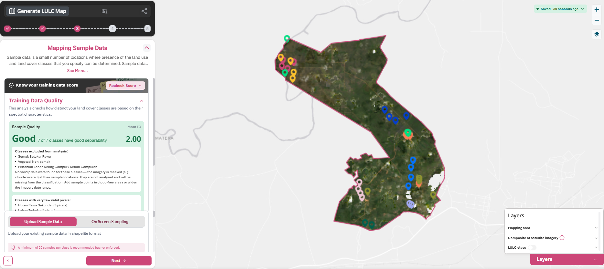

### Step 3.b.b: Draw Area

**Overview**

This feature is coming soon.

# Step 4: Customize Mapping Parameters {#sec-map-generation-parameters}

**Overview**

The user can choose a set of predictors that optimize the discrimination of LULC classes in the classification model. Predictors are generated from three principal categories: spectral transformations (indices), terrain-based metrics, and distance-based metrics, capturing complementary spectral, topographic, and spatial information.

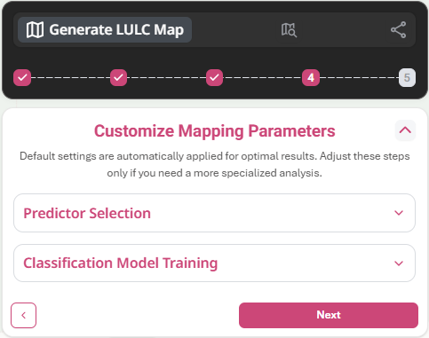

## Step 4.1: Predictor Selection {#sec-map-generation-predictors}

**Overview**

The user is prompted to select the predictors currently supported by Luma Geospatial Engine by using check boxes or upload their own predictor data in `.zip` file.

### Step 4.1.a: Default Predictors

**Overview**

The user selects the predictors currently supported by Luma Geospatial Engine by using check boxes.

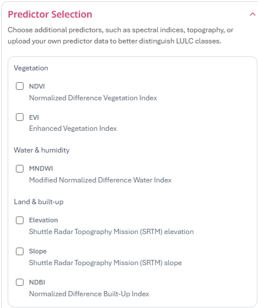

**Prerequisite to Occurring**

1.  The user chose "Own Classification" in @sec-map-generation-lulc-classification-2a.

**User Input to Interface**

1.  The user selects the predictors by using check boxes.

**Process**

1.  (Interface) The system retrieves the predictors based on the user's selection.

    **Input from User:** Selected predictors.

    **Outcome:** Continue to Process 2.

2.  (GE) The system runs the functions in @sec-selection-of-predictors.

    **Input from Interface:** Selected predictors.

    **Outcome:** Continue to Process 3.

3.  (Interface) The system returns the calculated predictors.

    **Input from GE:** Calculated predictors.

    **Outcome:**

    - "Next" button leads to Summary of LULC List Parameters showing the predictors selected and Random Forest Variable in a purple box.
    - Two buttons appear:
      - "Change Input"; continue to Process 4
      - "Next"; continue to Process 5

4.  (Interface) The system saves all input.

    **Input from User:** The user clicks on "Change Input".

    **Outcome:** "Edit" (pencil icon) appears next to each parameter; if clicked, a pop up window appears asking if user wants to:

    - "Change Input"; all inputs being reset and back to the beginning of @sec-map-generation-parameters
    - "Discard Changes"; stay in Process 4 with "Cancel Change" button activated

5.  (Interface) The system generates map with all input from Step 1-4.

    **Input from User:** The user clicks on "Next" button.

    **Outcome:** A pop up window appears with User’s Input Summary and Summary of LULC Class Compositions in purple boxes, with a "Generate Map" button. Continue to @sec-map-generation-final.

6.  (Interface) The system saves all input.

    **Input from User:** The user clicks on the "Back" (chevron) button.

    **Outcome:** The panel of @sec-map-generation-sample-data Sample Data Summary is being shown. The user has to click the "Next" button to go back to the last edited panel in @sec-map-generation-parameters.

### Step 4.1.b: Upload Predictors

**Overview**

This feature is coming soon.

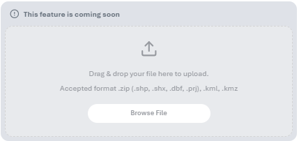

## Step 4.2: Classification Model Training {#sec-map-generation-model-training}

**Overview**

The user is given the option to adjust the classification model by adjusting the value of the Random Forest variable to classify the satellite images into land use and land cover classes using training data. The default value of the Random Forest parameters are 150 number of trees and 1 minimum leaf population. The user is also prompted to define the proportion to split the sample data into training and validation dataset. The default value of the dataset proportion is 70% for training data and 30% for validation data.

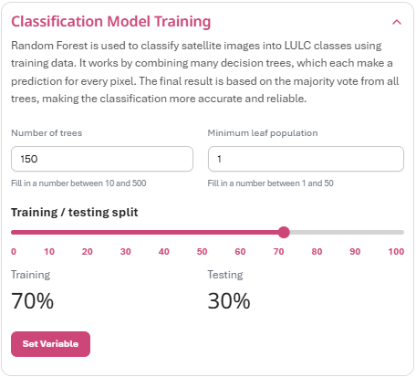

**Prerequisite to Occurring**

1.  The user chose "Own Classification" in @sec-map-generation-lulc-classification-2a.

**User Input to Interface**

1.  The user configures the classification parameters for number of trees and minimum leaf population.

2.  The user defines the proportion to split the sample data into training and validation dataset.

**Process**

1.  (Interface) The system verifies the inputs and runs the process to create the classification model.

    **Input from User:** Selected Random Forest parameters and Training/Testing Split.

    **Outcome:** Continue to Process 2.

2.  (GE) The system runs functions in @sec-create-classification-model to train a Random Forest classifier using extracted training data and applies it to the input imagery to produce a hard (pixel-level) multiclass.

    **Input from Interface:** Selected Random Forest parameters.

    **Outcome:** Continue to Process 3.

3.  (GE) The system uses stratified random split method to conduct the data splitting by performing stratified random split of sample data based on LULC class labels with functions in @sec-data-split.

    **Input from Interface:** Sample data split proportion.

    **Outcome:** Continue to Process 4.

4.  (Interface) The system returns the processed parameters.

    **Input from GE:** Processed parameters.

    **Outcome:** "Set Variable" button leads to Summary of LULC List Parameters showing the predictors selected and Random Forest Variable in a purple box. Two buttons appear:

    - "Change Input"; continue to Process 5.
    - "Next"; continue to Process 6.

5.  (Interface) "Edit" (pencil icon) appears next to each parameter.

    **Input from User:** The user clicks on "Change Input".

    **Outcome:** A pop up window appears asking if user wants to:

    - "Change Input"; all inputs being reset and back to the beginning of @sec-map-generation-parameters.
    - "Discard Changes"; stay in Process 5 with "Cancel Change" button activated.

6.  (Interface) The system generates map with all input from Step 1-4.

    **Input from User:** The user clicks on "Next" button.

    **Outcome:** A pop up window appears with User’s Input Summary and Summary of LULC Class Compositions in purple boxes, with a "Generate Map" button. Continue to @sec-map-generation-final.

7.  (Interface) The system saves all input.

    **Input from User:** The user clicks on the "Back" (chevron) button.

    **Outcome:** The panel of @sec-map-generation-sample-data Sample Data Summary is being shown. The user has to click the "Next" button to go back to the last edited panel in @sec-map-generation-parameters.

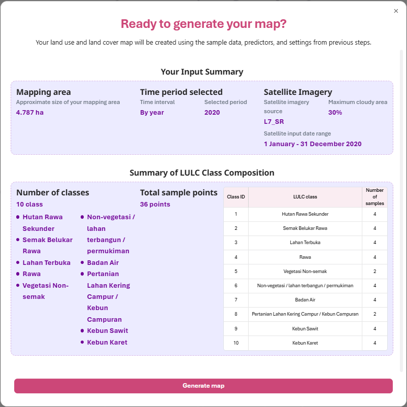

# Step 5: Map Generation {#sec-map-generation-final}

**Overview**

The user is shown the map generated on the map canvas with the classes in different colours, and the panel is showing model accuracy results, LULC class composition, and map’s thematic accuracy assessment process.

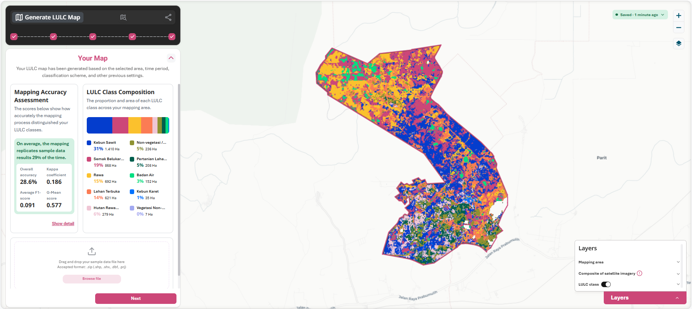

**Prerequisite to Occurring**

1.  The user completed Step 1-4.

## Step 5.1: Model Accuracy Assessment

**Overview**

The user is shown how accurately the mapping process distinguished their land use and land cover classes.

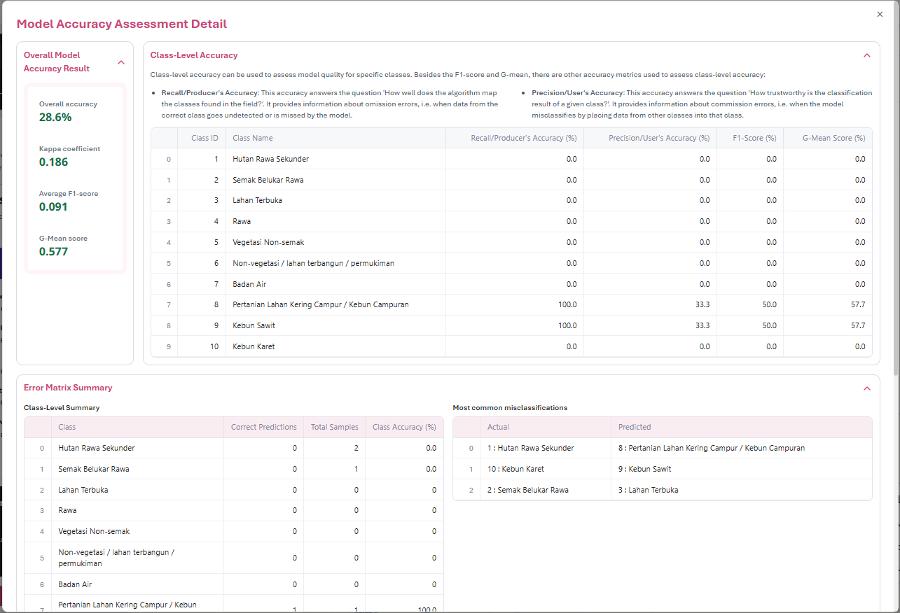

**User Input to Interface**

1.  The user clicks on "Show Detail".

**Process**

1.  (Interface) The system retrieves the mapping accuracy assessment result.

    **Input from User:** The user clicks on "Show Detail".

    **Outcome:** The system checks if there are any

    .shp

    file inside the

    .zip

    fileA pop up window shows:

    - Overall Model Accuracy Result
      - Overall accuracy
      - Kappa coefficient
      - Average F1-score
      - G-mean score
    - Class Level Accuracy
      - Recall/Producer’s accuracy
      - Precision/User’s accuracy
    - Error Matrix Summary
      - Class-level summary
      - Most common misclassifications
    - Confusion Matrix

    Two buttons appear at the bottom:

    - "Download Raw Data"; `.csv` file containing the raw data is downloaded to user’s local device
    - "Download Confusion Matrix Chart"; `.png` file of the confusion matrix is downloaded to user’s local device

## Step 5.2: LULC Class Composition

**Overview**

The user can visualize the LULC classification result on the map canvas along with the training data layer and is shown the proportion of each LULC class.

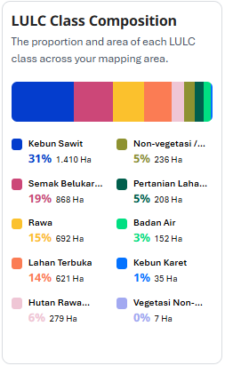

## Step 5.3: Thematic Accuracy Assessment

**Overview**

The user uploads an independent ground reference data in `.zip` file to perform a comprehensive thematic accuracy assessment of the land cover map.

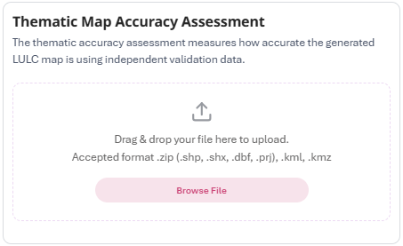

**User Input to Interface**

1.  The user uploads validation data in a `.zip` file.

**Process**

1.  (Interface) The system checks if there are any `.shp` file inside the `.zip` file.

    **Input from User:** The user uploads `.zip` file containing the ground reference data.

    **Outcome:** Continue to Process 2.

2.  (GE) The system verifies if the `.shp` of the validation map is the uploaded inside the `.zip` file by running the relevant functions in @sec-thematic-accuracy-assessment.

    **Input from Interface:** `.shp` sample data inside the `.zip` file.

    **Outcome 1:** The system shows a confirmation if the sample data is successfully verified. Continue to Process 3.

    **Outcome 2:**

    ::: callout-important
    ## Error Handling Notification

    The system provides an error notification if the system fails to conduct the data verification.
    :::

3.  (GE) The system conducts geometry fixes on the uploaded validation map by running the relevant functions in @sec-thematic-accuracy-assessment.

    **Outcome 1:** Continue to Process 4.

    **Outcome 2:**

    ::: callout-important
    ## Error Handling Notification

    The system provides an error notification if the system fails to run the geometry validation and fixes.
    :::

4.  (GE) The system converts the validation map from `.gdf` data into Earth Engine Feature Collection format by running the relevant functions in @sec-thematic-accuracy-assessment.

    **Outcome 1:** Continue to Process 5.

    **Outcome 2:**

    ::: callout-important
    ## Error Handling Notification

    The system provides an error notification if the system fails to convert the validation map data.
    :::

5.  (GE) The system performs a thematic accuracy assessment by validating inputs, sampling the classified LULC map at reference points.

    **Outcome 1:** Several accuracy metrics is calculated to provide comprehensive report of the map’s thematic quality. Continue to Process 6.

    **Outcome 2:**

    ::: callout-important
    ## Error Handling Notification

    The system provides an error notification if the system fails to run the thematic accuracy assessment.
    :::

6.  (Interface) The system returns the calculated accuracy metrics in the form of comprehensive report of the map's thematic quality.

    **Input from GE:** Calculated accuracy metrics.

    **Outcome:** A pink box showing the Thematic Accuracy Result appears with overall prediction, Kappa coefficient, number of points correct and wrong. Two actions can be chosen:

    - "Reupload validation data"

    - "Show detail"; continue to Process 8

7.  (Interface) The system saves all input.

    **Input from User:** The user clicks on "Reupload validation data".

    **Outcome:** Continue to the beginning of @sec-map-generation-final.

8.  (Interface) The system previews the comprehensive report of the map's thematic quality.

    **Input from User:** The user clicks on "Show detail".

    **Outcome:** A pop up window shows:

    - Overall Model Accuracy Result

    - Overall accuracy

    - Kappa coefficient

    - Average F1-score

    - G-mean score

    - Class Level Accuracy

    - Recall/Producer’s accuracy

    - Precision/User’s accuracy

    - Error Matrix Summary

      - Class-level summary

      - Most common misclassifications

    - Confusion Matrix

    Two buttons appear at the bottom:

    - "Download Raw Data"; `.csv` file containing the raw data is downloaded to user’s local device.

    - "Download Confusion Matrix Chart"; `.png` file of the confusion matrix is downloaded to user’s local device.

9.  (Interface) The system previews the comprehensive report of the map's thematic quality.

    **Input from User:** The user clicks on the "Next" button.

    **Outcome:** A pop up window shows several options:

    - "Download map"; user is prompted to log in/sign up, continue to Feature 2

    - "Share map"; user is prompted to log in/sign up, continue to Feature 3

    - "Save to my account" (currently disabled)

    - "Improve accuracy"; user can improve the accuracy of their generated map, continue to Feature 4.

# Additional Features

**Overview**

The user can save their land use and land cover mapping progress and share their mapping results by logging in/signing up to an Epistem account. Once logged in, user account is activated on the upper right corner of the screen with the user’s initial or profile picture.

## Feature 1: Save Progress

**Overview**

Once logged in, the user can save their land use and land cover mapping progress, name the map they are working on, and view which steps they have done and where they are currently in. This can be viewed on the upper right corner of the map canvas. The session is stored for up to 24 hours within the database.

**Process**

1.  The user clicks "Save" button.

2.  The user is prompted to log in or sign up for an Epistem account if they have not already registered.

3.  Once logged in, the user can name the map they are working on in order to save it.

4.  Progress is saved automatically; completed steps and the user's current position are visible in the top-right corner of the map canvas.

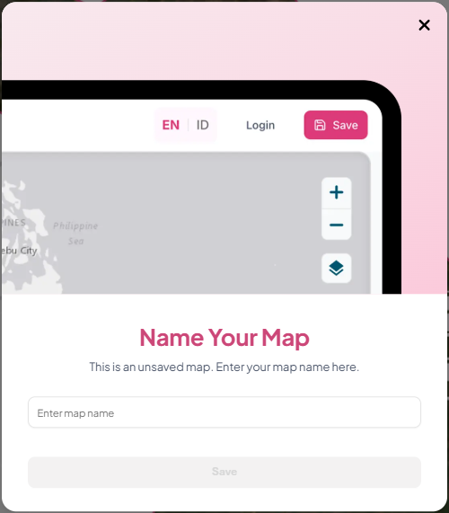

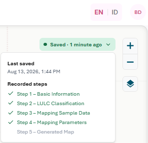

## Feature 2: Download Map

**Overview**

Once logged in, the user can download their generated map.

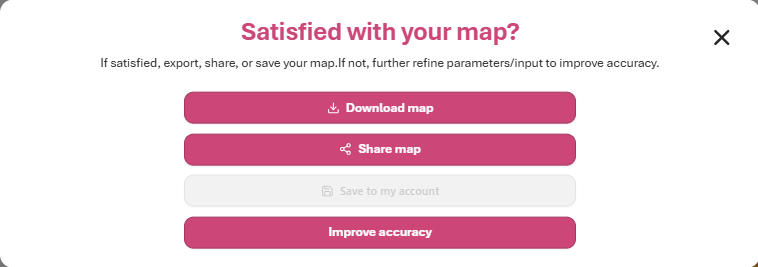

**Process**

1.  The user downloads their map.

2.  The system sends an email containing the exported LULC map with a download link.

    ::: callout-note
    ## Success Notification

    The user receives an email from [webdev\@epistem.io](mailto:webdev@epistem.io) containing a download link to the GeoTIFF of the exported map
    :::

## Feature 3: Share Map

**Overview**

Once logged in, the user can share their generated map to another person with an email address.

**Process**

1.  The user input recipient's name and email address.

2.  The system sends and email to the recipient containing the exported LULC map with a download link.

    ::: callout-note
    ## Success Notification

    The recipient receives an email from [webdev\@epistem.io](mailto:webdev@epistem.io) containing a download link to the GeoTIFF of the exported map
    :::

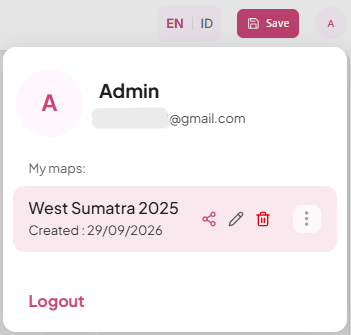

## Feature 4: Improve Accuracy

**Overview**

The user can improve the accuracy of their generated map in two ways: by resetting the parameters in @sec-map-generation-parameters, or by adding or editing the sample data in @sec-map-generation-sample-data.

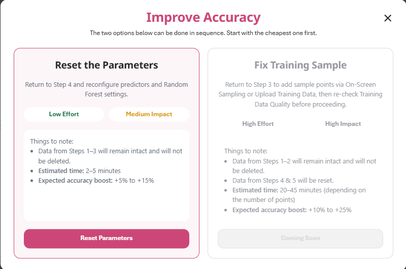

**Process**

1.  The user clicks on “Improve Accuracy”.

    ::: callout-note
    ## Success Notification

    A pop up window showing two methods of improving accuracy:

    - ”Reset Parameters”; continue to Process 2

    - ”Fix Training Data”; continue to Step 3 (coming soon)
    :::

2.  If the user clicks on ”Reset Parameters”, the system retrieves information from Step 4.

    ::: callout-note
    ## Success Notification

    The panel returns to the beginning of @sec-map-generation-parameters, with all selected predictors still checked, and displays a message explaining that the user is in Improvement Mode.
    :::